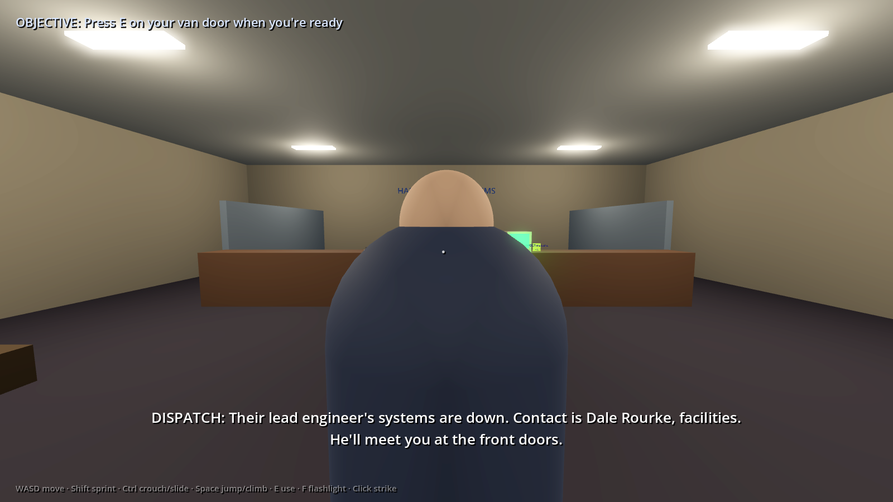
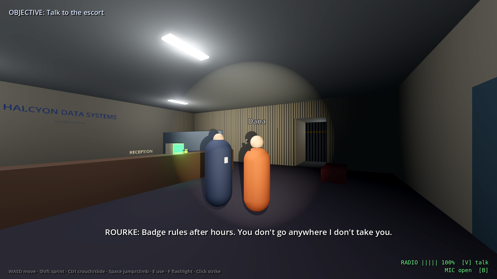

# Null & Void

A first-person co-op survival-horror escape game where the only way out is to write real code.
You're a contract IT crew trapped inside Halcyon Data Systems in 1997. The doors, lights and
robots are rows in a real SQLite database, and you learn SQL (then HTTP, JavaScript, HTML/CSS
and testing) by using it to survive.

The full design is in [docs/game-plan.md](docs/game-plan.md).



## Status

Playable now: **the ground floor and floors 14 and 22** of Halcyon Tower, solo or co-op
(1 to 6 players), furnished art, subtitles for placeholder voices.

- **Ground floor, the lobby:** check in with security, get your visitor badges, and piece
  together a shredded memo with your first queries (`SELECT`, `FROM`, `ORDER BY`).
- **Floor 14, the server floor:** the job you were hired for. Track down the faulty door
  controllers with `WHERE` and reset the right rack. The faulty rack changes every run.
- **Floor 22, the security floor:** filter, sort and count your way
  through the guards' own records.

## Changelog

Newest first. Floors are listed by their in-game floor number.

### 2026-10-20
- **New:** notes huddles in co-op. Press E on a teammate to huddle up, and anyone can join by pressing E on someone in it. Then share a line, a whole case page or every case, and it fills in the same case page in their notebooks.
- **New:** in the co-op lobby, choose who you play (twelve crew members across two body types), your polo colour and your skin tone, with a turning preview.
- **New:** sit down on a chair (E) or on the floor (Z). Running, jumping and climbing tire you; stand still to get your breath back.
- **New:** the game opens in the crew's garage, with a short controls intro. The crew huddles round *Easy SQL* to read a chapter aloud and vote on its quiz together, and flashes back to the garage when a new chapter is needed.
- **New:** health and stamina bars, and blocking (right-click just before a hit lands). In co-op, a teammate can help you up when you go down.
- **New:** the tower elevator now serves its real floors, and stairwells link every floor ("in case of emergency, do not use elevators").
- **New:** the tower exterior, and a badge reader at the front gate.
- **New:** *Easy SQL*, the crew's beginner's book, rides along in the van, with practice kits.
- **Added:** case pages in the notebook, a guest check-in at the front desk, and a ledge route on the security floor.
- **Added:** dressed fire stairs (handrails, floor numbers, emergency lights), a model for Maddison, the crew's boss, and the groundwork for crew customisation: two body types, eight skin tones, and tintable hats, tops, jackets, glasses and earrings.
- **Changed:** each paper and sticky note exists only once, so the crew has to pool what it finds.
- **Fixed:** playtest rounds 7 and 8, plus a quality pass across all three floors.

### 2026-10-19
- **New:** a hotbar for carried items, and visitor badges.
- **New:** see what a teammate is typing on a terminal.
- **Changed:** deeper puzzles and clearer in-world clues on the ground floor and floors 14 and 22.
- **Fixed:** art and lighting issues; more automated teaching tests.

### 2026-10-18
- **New:** every level is now a whole floor of the tower.
- **Added:** realistic papers and documents, and furniture on all three floors.
- **Changed:** you can look around a paper's edges while reading it.

### 2026-10-17
- **New:** the notebook, sticky notes and the elevator.
- **New:** terminal tips from SYSOP, and papers pinned to walls.
- **Changed:** the notebook and terminal screens are held in your hands.
- **Fixed:** co-op sync issues and playtest rounds 3 to 5.

### 2026-10-16
- **New:** the first playable slice: the lobby and the server floor, built in Godot 4.7.
- **New:** co-op for up to 6 players, with open-mic voice and walkie-talkie radios.
- **New:** parkour movement: slide, roll, mantle, ledge grab, climb, vents and shoulder stands.
- **New:** the van intro and one continuous building with no loading screens.
- **Added:** the voice script, early art and a teaching walkthrough for every puzzle.

## Roadmap

| Phase | What it covers | State |
|---|---|---|
| Foundations | Engine, co-op, movement, terminals, notebook | Done |
| First three floors | Ground floor, floors 14 and 22 | Done |
| Playtest and polish | Home base opening, crew characters, combat tuning, hints | Now |
| Act 2 | More floors of the tower, and new database skills (changing data, not just reading it) | Next |
| Act 3 | Deeper floors and new skills beyond SQL (HTTP, JavaScript, HTML/CSS) | Later |
| Finale | The last floors and the way out | Later |
| Ship | Steam lobbies, final art and recorded voices | Later |

## Play it

1. Install [Godot 4.7](https://godotengine.org/download) or newer (the standard version, not .NET). It's free.
2. Open Godot, choose **Import**, and select `project.godot` in this folder.
3. Press **F5** (or the Play button).

Controls: WASD move, mouse look, Shift sprint, Ctrl (or C) crouch, Shift+Ctrl slide,
Space jump/mantle, E use, X alternate action, F flashlight, left click strike, right click block, Esc pause.

Movement: hold W and jump at a high edge to grab it and hang; release W and press it
again to pull up (A/D shimmy, S or Ctrl let go, Space kick off). Tap Ctrl in the air to roll on landing, which is quiet. Walk into a pipe or
ladder to climb it. Crouch to crawl through vents (Shift in a vent bangs the duct). Step
onto a narrow ledge to shuffle along it. Look at a teammate and press E to climb onto
their shoulders, up to three high; Space jumps off. **Movement gym** on the main menu
has a station for each.

At a terminal: type SQL and press Enter. `.help`, `.tables`, `.schema NAME`, `.hint`, `.reset`.

### Co-op (2 to 6 players)



1. Everyone picks **Co-op** on the main menu and types a name.
2. One player presses **Host a game**. The lobby shows the address friends should use.
3. Everyone else types that address and presses **Join**. The host presses **Start**.

On the same network, use the address the lobby shows. Over the internet, the host forwards
UDP port 7777 on their router, or everyone joins the same free VPN such as
[Tailscale](https://tailscale.com) and uses the host's Tailscale address. (Steam lobbies come later.)

- **Voice:** up close, just talk (open mic; B mutes it).
- **Radio:** after you pick up the walkie-talkies, hold **V** to talk to everyone. It has a
  battery, gets crackly past about 35 m, dies out at 70 m, and fills with static near Rourke.
- Everyone shares one building: a query typed by anyone changes the doors for everyone, and
  everyone looking at a terminal sees what was typed on it.

## Tests

Every puzzle has an automated test proving it can be solved, and that the wrong approaches fail.

```sh
godot --headless --import   # run twice on a fresh checkout; see CLAUDE.md
godot --headless -s tests/run_tests.gd
```

CI runs the same tests on every push and pull request.

Review screenshots (needs a display; on a server use `xvfb-run`):

```sh
xvfb-run -s "-screen 0 1600x900x24" godot --rendering-driver opengl3 -s tools/screenshots.gd -- /tmp/shots
```

## Layout

| Path | What's there |
|---|---|
| `scripts/core/` | `Game` autoload (run state, input), `FacilityDB` (the building's SQLite database), `Puzzle` (result-set puzzle checks) |
| `scripts/player/` | First-person controller (slide, roll, mantle, ledge grab, climb, vents, ledges, shoulder stands) driven by `PlayerControls` so co-op can replay inputs; `MovementVolume` |
| `scripts/world/` | Greybox builders, `Traversal` helpers (vents, gates, climbables, ledges), doors driven by the database, terminals, triggers, interactables |
| `scripts/npc/` | Rourke |
| `scripts/net/` | Co-op: lobby, `Net` autoload, `LevelSync` (host-decided events, shared terminals), player puppets, voice and radio |
| `scripts/levels/` | One script per level; geometry is built in code |
| `scripts/ui/` | HUD, terminal screen, menu, Field Notes |
| `scripts/audio/` | The voice script (`voice_lines.gd`), recording playback, and the generator for `docs/script/` |
| `docs/script/` | The voice script and the recording list, generated from `voice_lines.gd` |
| `audio/voice/` | Voice recordings, named after their line id |
| `data/` | Seed SQL for levels |
| `addons/godot-sqlite/` | [godot-sqlite](https://github.com/2shady4u/godot-sqlite) (MIT), desktop binaries |
| `tests/` | Headless test runner |
| `docs/` | Design plan and screenshots |
