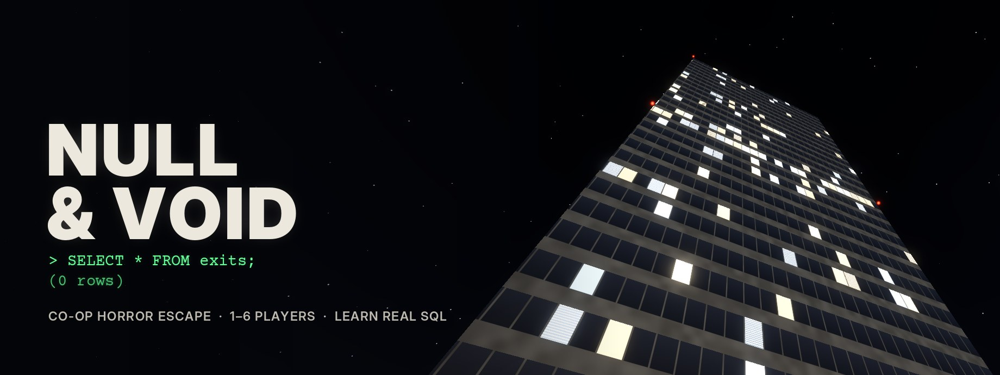
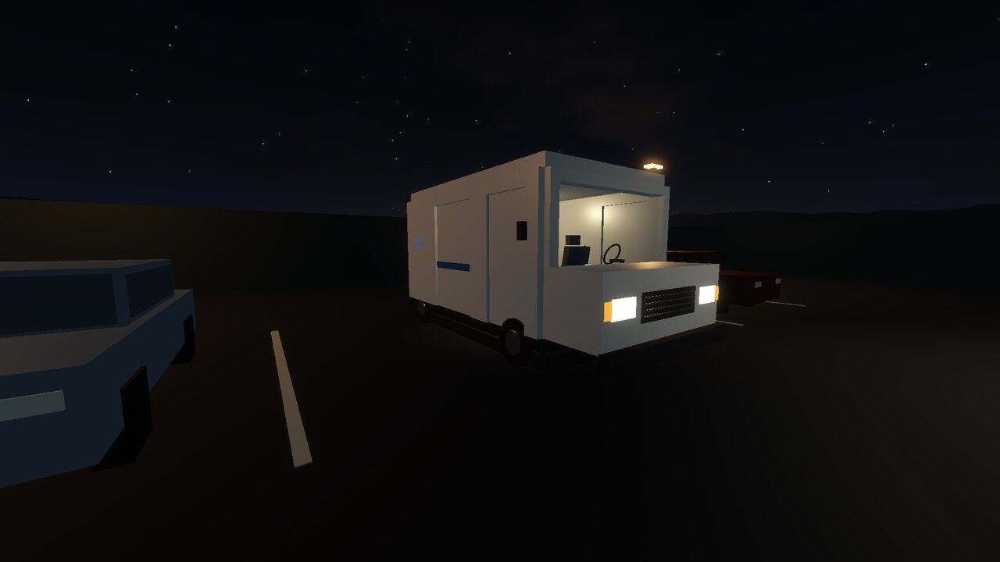
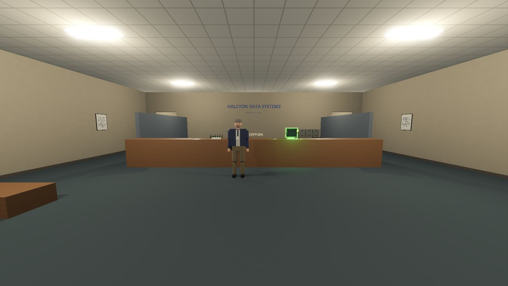
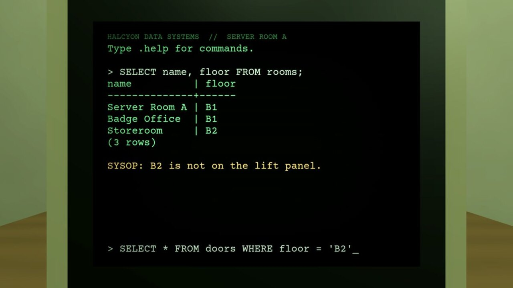
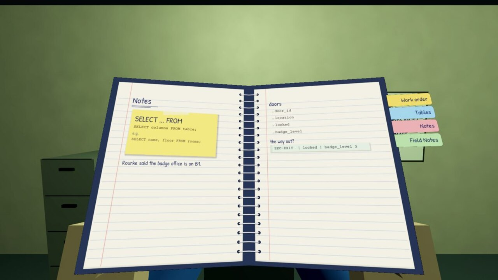
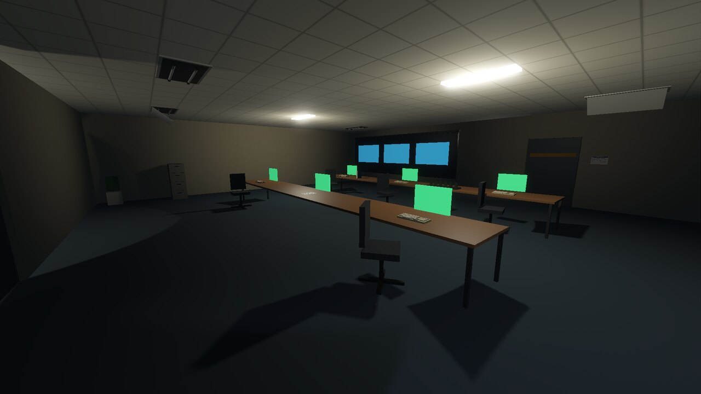
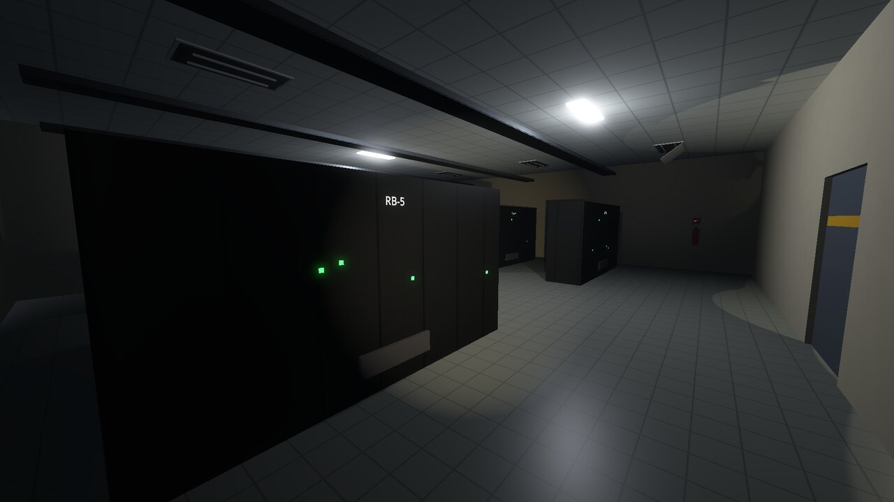
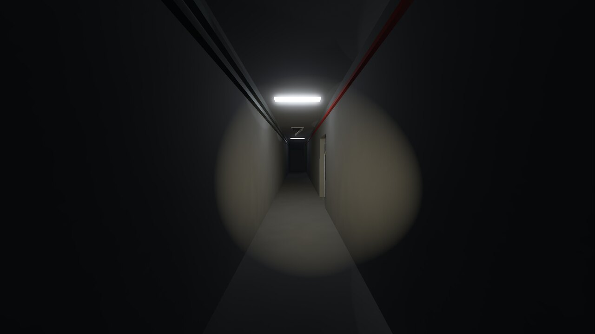
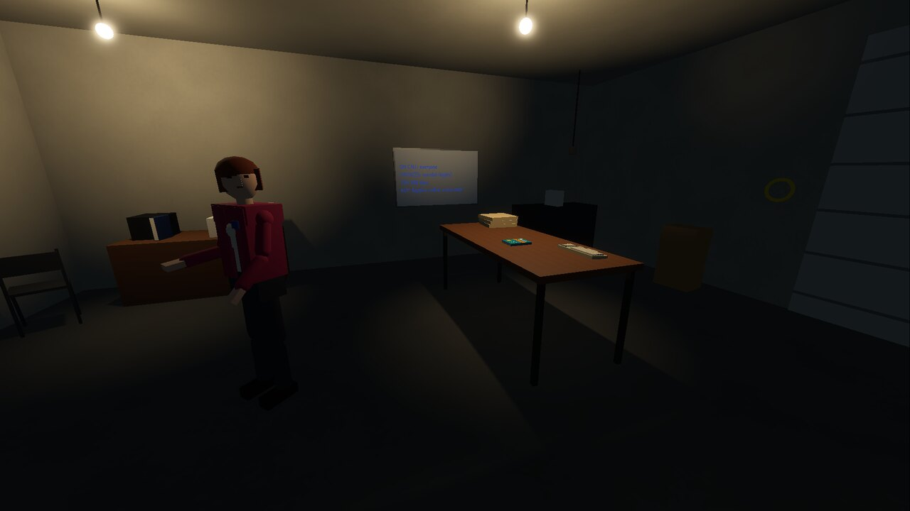

> [!IMPORTANT]
> ## Beta testers: start here
>
> **1. Get the game.** On this page, click the green **Code** button, then **Download ZIP**, and unzip it anywhere.
> Everyone playing together needs the same download, so grab a fresh one before each session.
>
> **2. Install Godot 4.7** (free, nothing else to install).
> - Download the **standard** version (not .NET) from [godotengine.org/download](https://godotengine.org/download).
> - **Windows:** unzip it and double-click the Godot `.exe`. **Mac:** open the `.dmg`, drag Godot to Applications, then right-click it and choose **Open** the first time.
> - In Godot, click **Import**, pick `project.godot` in the game's folder, then **Import & Edit**. The first import takes a minute or two.
> - Press **F5** (or the play button at the top right) to start the game.
>
> **3. Co-op over the internet: install Tailscale.** Everyone installs it from
> [tailscale.com/download](https://tailscale.com/download) and signs in with their own account.
> The host shares their computer and everyone joins the host's `100.x` address on port 7777:
> follow the [Tailscale co-op guide](docs/guides/tailscale-coop.md) the first time (about 10 minutes).
> Playing on the same wifi, or solo, needs no Tailscale.

<p align="center">
  
</p>

<p align="center">
  <b>A first-person co-op survival-horror escape game where the only way out is to write real code.</b>
</p>

<p align="center">
  <code>Co-op</code> <code>Horror</code> <code>Puzzle</code> <code>Programming</code> <code>Educational</code> <code>First-Person</code> <code>Escape</code> <code>1990s</code>
</p>

<table align="center">
  <tr><td><b>Genre</b></td><td>Co-op survival horror, puzzle, learn-to-code</td></tr>
  <tr><td><b>Players</b></td><td>1 to 6, online co-op</td></tr>
  <tr><td><b>Setting</b></td><td>Halcyon Tower, a downtown office tower, one night in October 1997</td></tr>
  <tr><td><b>Skills you learn</b></td><td>SQL now; HTTP, JavaScript, HTML/CSS and testing later</td></tr>
  <tr><td><b>Engine</b></td><td>Godot 4.7</td></tr>
  <tr><td><b>Status</b></td><td>In development: the ground floor and floors 14 and 22 are playable</td></tr>
  <tr><td><b>Release</b></td><td>To be announced</td></tr>
</table>

## Screenshots

<table>
  <tr>
    <td width="50%"><br><sub>The after-hours callout.</sub></td>
    <td width="50%"><br><sub>Check in at the front desk.</sub></td>
  </tr>
  <tr>
    <td><br><sub>Every terminal runs real SQL.</sub></td>
    <td><br><sub>Copy what you find into your notebook.</sub></td>
  </tr>
  <tr>
    <td><br><sub>The server floor, the job you were hired for.</sub></td>
    <td><br><sub>Find the faulty rack. It changes every run.</sub></td>
  </tr>
  <tr>
    <td><br><sub>Some corridors are better crossed quickly.</sub></td>
    <td><br><sub>Home base: a garage, a whiteboard and <i>Easy SQL</i>.</sub></td>
  </tr>
</table>

## About this game

It's October 1997. Byte-Right IT Services is a small crew who learned most of what they know
from a paperback called *Easy SQL*. They take an after-hours call from Halcyon Data Systems about
"a database problem". It should be an easy job. Then the doors lock.

Halcyon Tower runs on a real SQLite database. Every door, light and camera is a row in a table,
and the only way through is to query it. Search the paper trail the staff left behind, piece
together sticky notes and shredded memos, copy what matters into your notebook, and type real
SQL into the building's terminals to get the next door open.

### Features

- **Real SQL, not a mini-game.** You type genuine queries (`SELECT`, `WHERE`, `ORDER BY`,
  `COUNT` and more) into a real database. Puzzles check your results, not your wording, so any
  query that gets the right rows works.
- **No coding experience needed.** The crew's book teaches one idea at a time. Each idea is
  found in the world first and practised once safely before it counts, and help is on hand at
  every terminal when you're stuck.
- **Co-op for 1 to 6 players.** Split up across a floor, talk up close or over walkie-talkies
  with real range and static, and pool your notes in huddles. A query typed by anyone changes
  the building for everyone.
- **Every run is different.** Codes, faults and clues are shuffled each run, so a walkthrough
  can't carry you.
- **One continuous tower.** Each floor is part of the same building, with no loading screens.
- **Move like you mean it.** Slide, mantle, climb, crawl through vents, shuffle along a ledge 22
  floors up, or climb onto a teammate's shoulders.
- **Make the crew yours.** Pick from 12 crew members, set your own name and colours, and unlock
  outfits and tool skins by reading, fighting well, finishing floors and finding secrets.

### System requirements

The game runs from source for now (see [Play it](#play-it)).

- **OS:** Windows, macOS or Linux
- **Software:** [Godot 4.7](https://godotengine.org/download), the standard version (free)
- **Graphics:** a graphics card with Vulkan support
- **Online co-op:** a home network, or a free VPN such as Tailscale

## Status

The full design is in [docs/game-plan.md](docs/game-plan.md).


Playable now: **the ground floor and floors 14 and 22** of Halcyon Tower, solo or co-op
(1 to 6 players), furnished art, subtitles for placeholder voices.

- **Ground floor, the lobby:** check in with security, get your visitor badges, and piece
  together a shredded memo with your first queries (`SELECT`, `FROM`, `ORDER BY`).
- **Floor 14, the server floor:** the job you were hired for. Track down the faulty door
  controllers with `WHERE` and reset the right rack. The faulty rack changes every run.
- **Floor 22, the security floor:** filter, sort and count your way
  through the guards' own records.

## Changelog

Newest first, one version per day. Click a version to open it. Floors are listed by their in-game
floor number. Changes that have merged but aren't listed here yet are in [docs/changelog/](docs/changelog/).

<details open>
<summary><b>v0.6.0 - 2026-10-21</b></summary>

- **Changed:** cases with a single answer have a blank on their page. Point at the line that answers it, on a terminal or a paper, and click + add to notebook: the pen writes the answer in.
- **Added:** every row of a query result can be pointed at and added to your notebook on its own.
- **Changed:** Maddison now takes the crew through Easy SQL on her whiteboard, and a page turns once everyone is ready to move on.
- **Added:** in co-op you see your teammates punch, guard and flinch.
- **Changed:** the garage's briefing corner has a proper old couch, a kitchen counter with the coffee on, and red diner stools.
- **Changed:** the outside of the garage is dressed: a steel roll-up door with windows, lamps, the company sign, the bins and the driveway.
- **New:** Floor 10, the Power Plant, down the stairs from the Records Archive. Change rows with UPDATE, add them with INSERT, and find out why every write needs its WHERE.
- **Added:** a gantry arm you drive by code, for a second way into a locked room.
- **New:** a new opening in front of the crew's garage, solo or co-op: walk in, pick your look and pose, and get ready together.
- **Changed:** the game now opens with the crew walking into the garage and taking a seat facing Maddison. She briefs you, sends you to the punch bag, has you check the work order in your notebook, and sends one of you for the book. Playing solo, she talks to just you.
- **Added:** whoever fetches Easy SQL carries it in their hands until they sit down with it.
- **Fixed:** blocking the punch bag now tells you it worked.
- **Added:** look down and you see your own body. Swing, block or take a hit and your own arms throw the punch, hold the guard or jolt back in front of you.
- **Changed:** Easy SQL huddles now quiz each word right after it's taught, and keep the table or page you need on show beside questions that aren't testing your memory.
- **Fixed:** chapter zero's quick checks only ask about what chapter zero teaches.
- **Fixed:** subtitles no longer hide behind the open Easy SQL book.
- **Fixed:** every sticky note goes into your notebook, as a clue on its case page or under Other notes. None of them opens up as a paper any more.
- **Fixed:** long case titles and notes wrap on their own page instead of running over the binding.
- **Changed:** while reading the notebook or a paper, the pointer reaches every part of it, and pushing it past the edge turns your view. Right-click no longer looks around, and the pages' buttons always respond.
- **Fixed:** you arrive at the building in the same van seat you took in the garage.
- **Fixed:** on every floor, each chapter of the crew's book comes up just before the puzzle that uses it, so you've read every new word before you need it.
- **Fixed:** Rourke's mustache is a real mustache now, and open jackets no longer show ragged bits of shirt over the shoulders.
- **Changed:** ID badges on lanyards and shirts are printed cards with a photo, not blank white tiles.
- **Fixed:** people step round when they turn on the spot instead of sliding on still feet.
- **Fixed:** people no longer stoop forward when they stand still; they stand up straight.
- **Changed:** the garage has a real fax machine, and its van is the same Byte-Right van you ride to work in.
- **Changed:** the crew's garage is bigger and brighter, with seats for the whole crew facing Maddison's whiteboard, and Maddison takes her time.
- **Added:** a Customize button on the main menu, so you can pick who you play and how you look before a solo game.
- **Changed:** you feel a hit land: the view shakes and you stagger back a step. A block jolts you too, more softly.
- **Fixed:** sitting on a chair no longer pins your view straight ahead. Seated, you can look around as far as a seated person could: most of the way to each side, and comfortably up and down.
- **Added:** the chairs on the ground floor and floor 14 can be sat on: reception, the cafeteria, the network room and the break room.
- **New:** unlockable items. Read the crew's book, block a hit in a real fight and finish floors to unlock new clothes and tool skins in the co-op lobby. Locked pieces show in the lobby with a hint on how to earn them, and a few secret ones stay hidden until you find them.
- **Added:** finishing floor 22 unlocks the Security jacket.
- **Changed:** each unlock goes to the player who earned it: whoever picks up *Easy SQL*, each player who reads a chapter in the huddle, and the player who makes the block. Finishing a floor unlocks its item for everyone who finished it.
- **Added:** an Achievements tab in the co-op lobby, and a notice when you earn one. Secret ones stay hidden until you find them.
- **New:** floor 18, the Records Archive. The stairs down from 22 lead to a records floor at night, with a reading room, towering stacks you can climb and cross along the tops, rolling shelving on hand cranks, and side rooms whose doors shut.
- **Added:** the Records Archive is furnished: steel stacks full of archive boxes with ladders up their ends, a panelled reading room with its card catalogue, rolling shelving in the side rooms, shredders and a conveyor in the shredding room, and the microfiche room.
- **Added:** something on floor 18 hunts by sound. Sprint, land hard or turn a crank and it hears you; crouch and move slowly and it doesn't. It can't be blocked, so climb.
- **Added:** new puzzles at the records desk teach four more SQL words, each found first on papers around the floor. Any correct form of an answer is accepted.
- **Added:** finish floor 18 to unlock a new notebook sticker in the co-op lobby.
- **Added:** the archive box label for your notebook is drawn: it sticks up from the cover like an index tab, and goes on any cover.
- **Added:** hint ladders for every station on floor 18, and tips on its desk terminal.
- **Added:** two new Easy SQL chapters, DISTINCT and GROUP BY, read with the crew on floor 18.
- **Added:** Easy SQL teaches LIMIT in "Newest first", and has a new chapter on COUNT.
- **Added:** LIMIT on the ground floor: the visitor log can be cut down to its last few rows, and a sticky on the front desk shows how.
- **Added:** a new step on floor 14: before the door controller reset, count the faulted controllers for its sign-off form, with COUNT.
- **Changed:** notebook stickers and clips are picked on their own in the Gear tab, so they go on any notebook cover.
- **Changed:** the crew and everyone in the building are now smooth, clothed low-poly people instead of blocky figures, with jackets, lanyards, hair and hats that follow every pose.

</details>

<details>
<summary><b>v0.5.0 - 2026-10-20</b></summary>

- **Added:** block a hit in a real fight to unlock the High-tops. The garage punch bag doesn't count.
- **Fixed:** in co-op, a teammate sitting on a chair or on the floor is shown sitting, not crouching.
- **Added:** the lobby's waiting chairs can be sat on, and finishing the ground floor and floor 14 each unlock an item.
- **New:** dress your character in the co-op lobby. Crew, Look and Gear tabs let you pick hair, hat, top, jacket, glasses, earrings and more, a colour for each, and the colour of your flashlight, walkie, notebook and terminal screen. A shared terminal takes the screen colour of whoever sat down first. Your name and picks are saved for next time.
- **Added:** the crew jots down what people tell them. Spoken tasks go on the Work order, and facts go on the case page or under Other notes, so a missed line can be read back.
- **Added:** the garage's folding chairs can be sat on.
- **New:** notes huddles in co-op. Press E on a teammate to huddle up, and anyone can join by pressing E on someone in it. Then share a line, a whole case page or every case, and it fills in the same case page in their notebooks.
- **New:** in the co-op lobby, choose who you play (twelve crew members across two body types), your polo colour and your skin tone, with a turning preview.
- **New:** sit down on a chair (E) or on the floor (Z). Running, jumping and climbing tire you; stand still to get your breath back.
- **New:** the crew's garage home base is furnished like a 1997 startup: bare bulbs, folding tables, CRTs, a whiteboard, pizza boxes, the Byte-Right banner, and *Easy SQL* on the bench.
- **New:** the game opens in the crew's garage, with a short controls intro. The crew huddles round *Easy SQL* to read a chapter aloud and vote on its quiz together, and flashes back to the garage when a new chapter is needed.
- **Changed:** Maddison is there in person in the garage, and at the bench whenever the crew huddles round the book.
- **Added:** a punch bag in the garage to practise blocking before the job.
- **New:** health and stamina bars, and blocking (right-click just before a hit lands). In co-op, a teammate can help you up when you go down.
- **New:** the tower elevator now serves its real floors, and stairwells link every floor ("in case of emergency, do not use elevators").
- **New:** the tower exterior, and a badge reader at the front gate.
- **New:** *Easy SQL*, the crew's beginner's book, rides along in the van, with practice kits.
- **Added:** case pages in the notebook, a guest check-in at the front desk, and a ledge route on the security floor.
- **Added:** dressed fire stairs (handrails, floor numbers, emergency lights), a model for Maddison, the crew's boss, and the groundwork for crew customisation: two body types, eight skin tones, and tintable hats, tops, jackets, glasses and earrings.
- **Added:** two puzzles on floor 14: track down the stuck doors, and an optional dark break room to light back up.
- **Changed:** Maddison, the crew's boss, is written in person into the garage opening and the book huddles of the voice script.
- **Changed:** each paper and sticky note exists only once, so the crew has to pool what it finds.
- **Fixed:** playtest rounds 7 and 8, plus a quality pass across all three floors.

</details>

<details>
<summary><b>v0.4.0 - 2026-10-19</b></summary>

- **New:** a hotbar for carried items, and visitor badges.
- **New:** see what a teammate is typing on a terminal.
- **Changed:** deeper puzzles and clearer in-world clues on the ground floor and floors 14 and 22.
- **Fixed:** art and lighting issues; more automated teaching tests.

</details>

<details>
<summary><b>v0.3.0 - 2026-10-18</b></summary>

- **New:** every level is now a whole floor of the tower.
- **Added:** realistic papers and documents, and furniture on all three floors.
- **Changed:** you can look around a paper's edges while reading it.

</details>

<details>
<summary><b>v0.2.0 - 2026-10-17</b></summary>

- **New:** the notebook, sticky notes and the elevator.
- **New:** terminal tips from SYSOP, and papers pinned to walls.
- **Changed:** the notebook and terminal screens are held in your hands.
- **Fixed:** co-op sync issues and playtest rounds 3 to 5.

</details>

<details>
<summary><b>v0.1.0 - 2026-10-16</b></summary>

- **New:** the first playable slice: the lobby and the server floor, built in Godot 4.7.
- **New:** co-op for up to 6 players, with open-mic voice and walkie-talkie radios.
- **New:** parkour movement: slide, roll, mantle, ledge grab, climb, vents and shoulder stands.
- **New:** the van intro and one continuous building with no loading screens.
- **Added:** the voice script, early art and a teaching walkthrough for every puzzle.

</details>

## Roadmap

| Phase | What it covers | State |
|---|---|---|
| Foundations | Engine, co-op, movement, terminals, notebook | Done |
| First three floors | Ground floor, floors 14 and 22 | Done |
| Playtest and polish | Home base opening, crew characters, combat tuning, hints | Now |
| Act 2 | More floors of the tower, and new database skills (changing data, not just reading it) | Next |
| Act 3 | Deeper floors and new skills beyond SQL (HTTP, JavaScript, HTML/CSS) | Later |
| Finale | The last floors and the way out | Later |
| Ship | Steam lobbies, final art and recorded voices | Later |

## Play it

1. Install [Godot 4.7](https://godotengine.org/download) or newer (the standard version, not .NET). It's free.
2. Open Godot, choose **Import**, and select `project.godot` in this folder.
3. Press **F5** (or the Play button).

Controls: WASD move, mouse look, Shift sprint, Ctrl (or C) crouch, Shift+Ctrl slide,
Space jump/mantle, E use, X alternate action, F flashlight, left click strike, right click block, Esc pause.

Movement: hold W and jump at a high edge to grab it and hang; release W and press it
again to pull up (A/D shimmy, S or Ctrl let go, Space kick off). Tap Ctrl in the air to roll on landing, which is quiet. Walk into a pipe or
ladder to climb it. Crouch to crawl through vents (Shift in a vent bangs the duct). Step
onto a narrow ledge to shuffle along it. Look at a teammate and press E to climb onto
their shoulders, up to three high; Space jumps off. **Movement gym** on the main menu
has a station for each.

At a terminal: type SQL and press Enter. `.help`, `.tables`, `.schema NAME`, `.hint`, `.reset`.

### Co-op (2 to 6 players)


1. Everyone picks **Co-op** on the main menu and types a name.
2. One player presses **Host a game**. The lobby shows the address friends should use.
3. Everyone else types that address and presses **Join**. The host presses **Start**.

On the same network, use the address the lobby shows. Over the internet, the host forwards
UDP port 7777 on their router, or everyone joins the same free VPN such as
[Tailscale](https://tailscale.com) and uses the host's Tailscale address ([setup guide](docs/guides/tailscale-coop.md)). (Steam lobbies come later.)

- **Voice:** up close, just talk (open mic; B mutes it).
- **Radio:** after you pick up the walkie-talkies, hold **V** to talk to everyone. It has a
  battery, gets crackly past about 35 m, dies out at 70 m, and fills with static near Rourke.
- Everyone shares one building: a query typed by anyone changes the doors for everyone, and
  everyone looking at a terminal sees what was typed on it.

## Tests

Every puzzle has an automated test proving it can be solved, and that the wrong approaches fail.

```sh
godot --headless --import   # run twice on a fresh checkout; see CLAUDE.md
godot --headless -s tests/run_tests.gd                       # everything
godot --headless -s tests/run_tests.gd -- --group=floor_22   # one group
```

The tests are split into groups (core systems, each floor, co-op, movement, teaching). CI runs
every group side by side on each push and pull request, so a run takes about as long as the
slowest group. Pull requests that only change docs skip the tests.

Review screenshots (needs a display; on a server use `xvfb-run`):

```sh
xvfb-run -s "-screen 0 1600x900x24" godot --rendering-driver opengl3 -s tools/screenshots.gd -- /tmp/shots
```

The cover and store screenshots in `docs/store/` come from `tools/store_shots.gd` (clean shots with
no HUD) and `tools/make_cover.py`; see the top of each file.

## Layout

| Path | What's there |
|---|---|
| `scripts/core/` | `Game` autoload (run state, input), `FacilityDB` (the building's SQLite database), `Puzzle` (result-set puzzle checks) |
| `scripts/player/` | First-person controller (slide, roll, mantle, ledge grab, climb, vents, ledges, shoulder stands) driven by `PlayerControls` so co-op can replay inputs; `MovementVolume` |
| `scripts/world/` | Greybox builders, `Traversal` helpers (vents, gates, climbables, ledges), doors driven by the database, terminals, triggers, interactables |
| `scripts/npc/` | Rourke |
| `scripts/net/` | Co-op: lobby, `Net` autoload, `LevelSync` (host-decided events, shared terminals), player puppets, voice and radio |
| `scripts/levels/` | One script per level; geometry is built in code |
| `scripts/ui/` | HUD, terminal screen, menu, Field Notes |
| `scripts/audio/` | The voice script (`voice_lines.gd`), recording playback, and the generator for `docs/script/` |
| `docs/script/` | The voice script and the recording list, generated from `voice_lines.gd` |
| `audio/voice/` | Voice recordings, named after their line id |
| `data/` | Seed SQL for levels |
| `addons/godot-sqlite/` | [godot-sqlite](https://github.com/2shady4u/godot-sqlite) (MIT), desktop binaries |
| `tests/` | Headless test runner |
| `docs/` | Design plan and screenshots; `docs/store/` holds the cover and the screenshots above |
